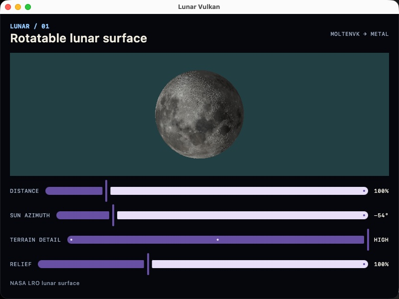
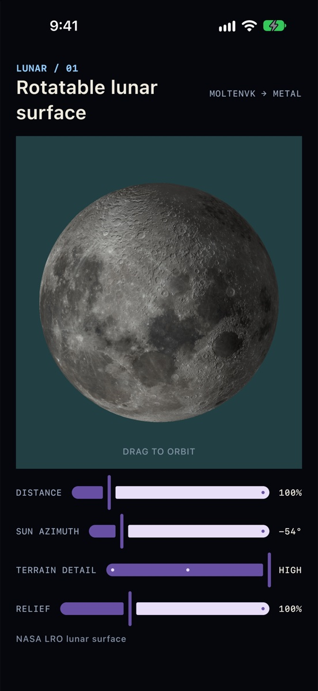
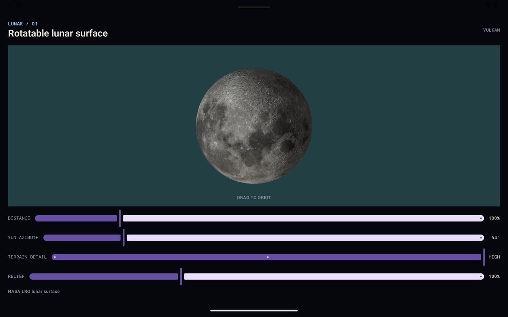

# Lunar Vulkan

A Compose Multiplatform application that draws a rotatable, relief-lit Moon with one C++ Vulkan renderer on Android, iOS, macOS, Windows, and Linux. The globe is built from NASA Lunar Reconnaissance Orbiter colour and elevation maps.

The goal is to show how a shared Kotlin UI can host native 3D graphics without pretending that every platform is the same. Compose owns the UI, the state, and the gestures. Each platform contributes only a native surface and a thin bridge. The renderer, its render thread, and its shaders are shared C++ and GLSL. Surface creation, swapchain pre-rotation, MoltenVK on Apple platforms, AWT/JAWT interop on the desktop, texture limits, and threading rules are all represented directly in the code.

<p>
  
  
</p>


The app is a single screen:

- **Globe** - one finger or the left mouse button orbits the Moon; two fingers, or a right or Shift drag on the desktop, pan it.
- **Distance** - frames the globe from 72% to 220%.
- **Sun azimuth** - moves the light and the terminator across the disc.
- **Terrain detail** - switches the sphere's tessellation between Low, Balanced, and High.
- **Relief** - controls the strength of the elevation shading.
- **About** - a small branded profile screen for the portfolio version of the app.

The header names the backend that is actually drawing: **Vulkan**, **MoltenVK → Metal**, or **Render preview** when no native renderer exists.

There is no dependency injection framework, no navigation library, no persistence layer, and no third-party rendering engine. The project keeps those things out of the way so the boundary between Compose and native Vulkan is easy to follow.

---

## Running the project

Clone the repository. All platforms need JDK 21 (Gradle provisions it) and CMake plus `glslc`, which the build finds in the Android SDK/NDK (`sdk.dir` in `local.properties`), the Vulkan SDK, or `PATH`. Either tool can be pinned in `local.properties` with `cmake=` or `glslc=`.

| Platform | Command | Additional requirements |
|---|---|---|
| Android | `./gradlew :androidApp:installDebug` | Android SDK with NDK |
| iOS | Open `iosApp/iosApp.xcodeproj` in Xcode and run | Xcode; MoltenVK is vendored in `third_party/` |
| macOS | `./gradlew :desktopApp:run` | Xcode command-line tools |
| Windows | `gradlew :desktopApp:run` | Visual Studio with the C++ workload; [LunarG Vulkan SDK](https://vulkan.lunarg.com/) |
| Linux | `./gradlew :desktopApp:run` | `sudo apt install cmake g++ libvulkan-dev libx11-dev glslc mesa-vulkan-drivers` |

To build an installer for the current desktop OS, run `./gradlew :desktopApp:packageDmg` (`packageMsi` on Windows, `packageDeb` on Linux). `:desktopApp:createDistributable` builds the app without an installer. The native library is bundled inside the app.

A Vulkan-capable GPU driver is required for the native renderer. On a machine or VM without one, the app starts and explains that Vulkan is unavailable instead of crashing. Linux VMs can use Mesa's lavapipe, which renders correctly on the CPU, slowly.

---

## Platforms

| Platform | Native surface | Vulkan | Bridge | Verified |
|---|---|---|---|---|
| Android | `SurfaceView` → `ANativeWindow` | System loader | JNI (`androidApp/src/main/cpp`) | Pixel Tablet emulator (API 35) |
| iOS | `UIView` → `CAMetalLayer` | MoltenVK | C API + cinterop (`shared/src/iosMain/native`) | Simulator; iPad Pro (A12Z) |
| macOS | AWT `Canvas` → `CAMetalLayer` (JAWT) | MoltenVK | JNI (`desktopApp/src/main/native`) | Apple M5 Pro |
| Windows | AWT `Canvas` → `HWND` (JAWT) | System loader | JNI | Intel UHD Graphics 770 |
| Linux | AWT `Canvas` → X11 window (JAWT) | System loader | JNI | Ubuntu 24.04 VM (launch only) |

iOS and macOS do not ship a Vulkan driver. On Apple platforms the same renderer runs through [MoltenVK](https://github.com/KhronosGroup/MoltenVK), which translates Vulkan to Metal. The renderer sticks to Vulkan 1.0 core plus the surface and swapchain extensions so it runs everywhere unmodified, and enables `VK_KHR_portability_subset` where MoltenVK advertises it.

Details and results for each device are in the [GPU validation log](docs/GPU_VALIDATION.md#results-log).

---

## What this demonstrates

### A narrow, typed boundary

The UI's `MoonView` (Kotlin) and `moon::ViewState` (C++) are the whole contract between Compose and the renderer: camera, light, and terrain settings cross it; no Vulkan handle or platform window type does. Each bridge hands the renderer a `VkSurfaceKHR` factory and decoded RGBA pixels, so the renderer never sees an `ANativeWindow`, a `CAMetalLayer`, an `HWND`, or an X11 window directly.

`MoonView` is a plain data class with orbit, pan, and clamp functions, a `Saver` for configuration changes, and unit tests. The renderer clamps every value again on its side, because values arriving across a C ABI should not be trusted.

### A dedicated render thread that draws on demand

After creation, only `moon::RenderThread` calls Vulkan. The UI thread writes the latest view and size into a mutex-guarded snapshot and wakes the thread, so slow frames never block input.

Frames are drawn when the view or size changes, or while the renderer has pending work such as swapchain recreation. FIFO presentation paces drawing while the user interacts, and an idle globe costs no GPU time or battery. A one-second heartbeat redraws for windowing systems that discard a window's contents when it is uncovered.

On Apple platforms the render thread file is compiled as Objective-C++ so every frame drains an autorelease pool; MoltenVK leaks drawables otherwise. The file `#error`s if the build is set up wrong.

### Android

`VulkanMoonSurface` hosts a `SurfaceView` in an `AndroidView`. Renderer creation (decoding two large maps and uploading them to the GPU) runs on a per-attachment worker so the UI does not drop frames. `surfaceDestroyed` waits for any creation still in flight. Out-of-memory while decoding is handled with a clear message rather than a crash.

The renderer implements swapchain **pre-rotation**: it presents with the surface's `currentTransform`, sizes the swapchain in the display's natural orientation, and rotates clip space to match. This avoids an extra compositor pass and the `VK_SUBOPTIMAL_KHR` Android otherwise reports on every present.

### iOS

`IosVulkanSurface` hosts a `UIView` that owns a `CAMetalLayer`. Kotlin/Native calls a small C API through cinterop: `create`, `resize`, `update_view`, `set_paused`, and `destroy`. There is no `render` call, because the render thread draws itself. Images cross as encoded bytes and are decoded natively with ImageIO.

The interop view is non-interactive, so touches reach the shared Compose gesture handling. The render thread pauses when the app enters the background, because iOS forbids GPU work there.

### Desktop

`DesktopVulkanSurface` embeds a heavyweight AWT `Canvas` through `SwingPanel` and reaches its native window through JAWT. That choice has consequences, each handled explicitly:

- Compose never sees mouse input over a heavyweight component, so the canvas reports drags itself.
- Compose popups would draw underneath the canvas, so `compose.layers.type=WINDOW` gives them their own windows.
- On Windows, Skiko's Direct3D renderer crashes natively when a popup gets its own window, so Compose draws with OpenGL there.
- macOS: the renderer is created during the window's initial layout; a Metal layer attached later stays hidden until the window is resized.
- Windows: `vulkan-1.dll` is delay-loaded and probed before first use, so the app starts on machines without a Vulkan driver.
- Linux: the bridge opens its own X connection instead of sharing AWT's `Display*` with the render thread.

### The renderer

`renderer/` is platform-neutral C++20 Vulkan:

- swapchain, depth buffer, render pass, and pipeline with dynamic viewport and scissor
- GPU selection that prefers a discrete GPU over integrated, and either over a CPU implementation
- an indexed UV sphere generated in code, rebuilt when terrain detail changes
- an sRGB albedo texture with blitted mipmaps and anisotropic filtering, on an sRGB swapchain
- an elevation map that displaces the surface in the vertex shader and rebuilds normals per pixel in the fragment shader, so crater rims stay sharp
- an orthographic projection whose depth range leaves room for displaced terrain (the near plane once clipped a hole in the middle of the globe)
- a per-swapchain-image "rendering finished" semaphore
- box-filter downsampling for textures larger than the GPU's `maxImageDimension2D`, since Vulkan guarantees only 4096 and the elevation map is 5760×2880
- setup steps that log which step failed, so a field report can be traced without a debugger

GLSL in `renderer/shaders/` is compiled to SPIR-V by `glslc` at build time and embedded in the library.

### Shared Compose UI

One `App` composable, one gesture handler, screen-reader support (a described globe with turn and tilt actions, named sliders), state that survives rotation, and a pure-Compose preview that stands in where no native renderer exists: unsupported desktops, IDE previews, and headless screenshot tests.

This is not intended to be a general-purpose rendering engine. If you bring the code into a production app, review the device coverage, memory budget, lifecycle handling, and GPU validation for your own requirements.

---

## Running the tests

```bash
./gradlew spotlessCheck          # Kotlin style (ktlint, configured in .editorconfig)
clang-format --dry-run --Werror renderer/*/*.cpp renderer/*/*.h   # C++ style (.clang-format)
./gradlew :shared:jvmTest        # Unit and Compose screenshot tests
```

The tests cover the deterministic parts of the app:

- `MoonView` orbit direction, clamping, pan limits, and state saving
- screen-reader descriptions and actions
- the About screen
- screenshot tests that render the shared shell headlessly with Skia and compare it with goldens in `shared/src/jvmTest/screenshots/`

Text rendering differs by OS, so goldens are per OS; macOS goldens are committed. Re-record after an intentional UI change with `./gradlew :shared:jvmTest -Pscreenshots.record=true`.

Nothing automated exercises a real GPU. The most important validation for this project is still real hardware, and [docs/GPU_VALIDATION.md](docs/GPU_VALIDATION.md) is the checklist and results log for it. After a change to the renderer, a platform bridge, the shaders, the textures, or MoltenVK, the process is: run the style checks and `:shared:jvmTest`, build every platform available, then work through the checklist on real hardware and add a row to its results log.

### Code style

- **Kotlin:** ktlint (IntelliJ IDEA style, 120 columns), configured in `.editorconfig`. `./gradlew spotlessApply` fixes formatting.
- **C++ / Objective-C++:** clang-format (Google style, 120 columns), configured in `.clang-format`.
- The renderer compiles with `-Wall -Wextra -Werror` under Clang (Android, Apple) and GCC (Linux). MSVC builds use `/W4` without warnings-as-errors.

---

## Constraints that are easy to break

These are not obvious from the code alone, and each one cost a debugging session. They are worth knowing before reusing any part of this project.

**Shared Kotlin**

- `commonMain` must not use `java.*` APIs such as `Math.PI`. They compile for Android and the desktop but not for Kotlin/Native (iOS). Use `kotlin.math`.
- `MoonView` and `moon::ViewState` must stay in step, including the order of `TerrainDetail`, whose ordinal crosses into native code.

**Native renderer**

- After creation, only the render thread may call Vulkan. Bridges talk to it through `moon::RenderThread`, whose public methods are thread-safe.
- On Apple platforms `renderer/thread/moon_render_thread.cpp` must be compiled as Objective-C++ (`LANGUAGE OBJCXX`) so each frame drains an autorelease pool; MoltenVK leaks drawables otherwise. The file `#error`s if this is missed.

**Desktop**

- One JDK must provide the JNI/JAWT headers, the linked JAWT library, and the runtime; mixing JDKs crashes inside JAWT. The build uses the JDK running Gradle unless `desktop.java.home` is set in `local.properties`.
- macOS: the renderer must be created during the window's initial layout. A Metal layer attached later stays hidden until the window is resized, so the textures are decoded in the background at launch, before the window appears.
- Linux: never share AWT's Xlib `Display*` with the render thread; the bridge opens its own X connection. Java runs through XWayland on Wayland desktops, so X11 covers both.
- Windows: `vulkan-1.dll` is delay-loaded and probed before first use, so the app still starts on machines without a Vulkan driver.

**Build**

- Native build steps are `NativeToolTask`s (from `build-logic/`), never Gradle `Exec` tasks. When a Gradle run configuration is debugged, IntelliJ's Kotlin/Native debugger takes over every `Exec` task and the build hangs.
- The desktop native library ships as a Compose app resource (`appResourcesRootDir`), which both `:desktopApp:run` and packaged apps expose as `compose.application.resources.dir`. Don't pass its path through `jvmArgs` on the run task: the Compose plugin overwrites them.

---

## Project structure

```
shared/                   Compose UI shared by every platform
  src/commonMain/         App, MoonView, gestures, accessibility, the Compose preview, lunar maps
  src/iosMain/            iOS surface (Kotlin) and its Objective-C++ bridge (native/)
  src/commonTest/         MoonView and accessibility unit tests
  src/jvmTest/            Screenshot tests and goldens
androidApp/               Android entry point, SurfaceView surface, and JNI bridge (src/main/cpp)
desktopApp/               Desktop entry point, AWT Canvas surface, and JNI/JAWT bridges for macOS, Windows, Linux
iosApp/                   SwiftUI host for the shared Compose UI
renderer/
  include/                Renderer interface, ViewState, RendererConfig
  src/                    Vulkan renderer: device, swapchain, pipeline, mesh, textures
  thread/                 Render thread shared by every bridge
  shaders/                GLSL, compiled to SPIR-V and embedded at build time
build-logic/              Gradle plugin for the CMake builds (tool discovery, NativeToolTask)
third_party/MoltenVK/     Vendored MoltenVK 1.4.2 static libraries and headers
docs/                     GPU validation checklist and results log, screenshots
```

---

## Tech stack

| | |
|---|---|
| Language | Kotlin 2.4.21, C++20, GLSL 450 |
| UI framework | Compose Multiplatform 1.12.2 with Material 3 |
| Graphics | Vulkan 1.0 core; MoltenVK 1.4.2 on iOS and macOS |
| Native build | CMake and `glslc`, driven from Gradle |
| Android Gradle Plugin | 9.1.1 |
| Android min SDK | 24 |
| Android target SDK | 37 |
| Tests | kotlin.test, Compose UI test, Skia screenshot tests |

---

## Assets and attribution

The lunar maps come from [NASA's CGI Moon Kit](https://svs.gsfc.nasa.gov/4720/), derived from Lunar Reconnaissance Orbiter camera and laser-altimeter data. Credit: **NASA's Goddard Space Flight Center**. Sources, conversions, and SHA-256 hashes are in [ASSET_NOTICE.md](ASSET_NOTICE.md). Retain this attribution in the repository, screenshots, and the companion article.

---

## About

Before Roy Watson wrote a line of Android code, he was programming the propellant management system for NASA's Delta launch vehicles, building radiation detection software for Los Alamos and Sandia National Laboratories, and developing embedded vision systems for IBM's autonomous vehicle research. After 30+ years as a systems developer, he approaches Android differently than most.

Over the past 17 years he has specialized in Android, staying current with every major evolution of the platform: Kotlin, Jetpack Compose, and, for the last two years, Kotlin Multiplatform and Compose Multiplatform for iOS, Desktop, and Web. Recent clients include the New York Public Library, Auddia, Bechtel, and Goodyear. When performance work requires dropping into C/C++, SIMD intrinsics, custom memory management, or GPU code, he does not hand it off.

His personal published apps have accumulated 70,000+ Android downloads (4.5-star) and 207,000+ iOS downloads (4.6-star). He studied Physics and Mathematics at Purdue University and is a member of Mensa International.

This project is part of a series of public examples demonstrating current Android and Compose Multiplatform architecture and patterns. The series begins with [Android Custom Theme](https://github.com/roywatson/android_custom_theme) and [Compose Multiplatform Custom Theme](https://github.com/roywatson/cmp_custom_theme), which build a complete custom theming system from first principles. Subsequent projects introduce [Dependency Injection with Koin](https://github.com/roywatson/cmp_di_koin), [DataStore Preferences](https://github.com/roywatson/cmp_di_koin_datastore_prefs), [HTTP networking with Ktor](https://github.com/roywatson/cmp_ktor), [Custom JVM Titlebars](https://github.com/roywatson/cmp_jvm_custom_titlebar), [Compose Multiplatform WebView](https://github.com/roywatson/cmp_webview), and [Android BLE Tools](https://github.com/roywatson/android_ble_tools). This project moves below the UI layer and hosts a native C++ Vulkan renderer inside a shared Compose Multiplatform app.

A companion article, [article_draft.md](article_draft.md), explains the design decisions in more depth.

Questions, corrections, or suggestions are welcome. Reach out through [roywatson.app](https://www.roywatson.app) or directly at rwatson@roywatson.com.

Available for contract and full-time engagements - [roywatson.app](https://www.roywatson.app)

[roywatson.app](https://www.roywatson.app) | [linkedin.com/in/roywatson3](https://linkedin.com/in/roywatson3) | [github.com/roywatson](https://github.com/roywatson)
